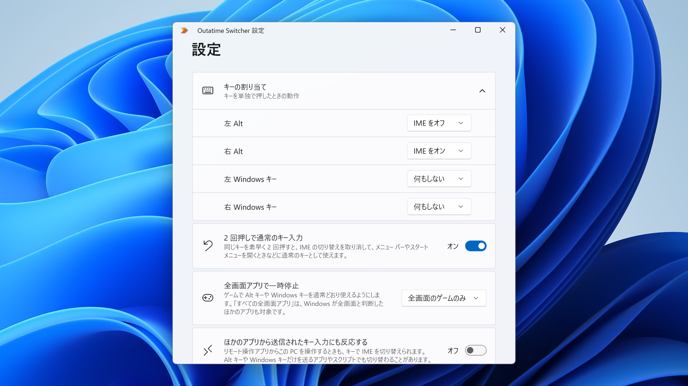

<div align="center">
  
  <h1>Outatime Switcher</h1>
  <a href="https://github.com/yk4to/outatime/actions/workflows/ci.yml"></a>
  
  <a href="LICENSE"></a>
  <br>
  <br>
  <a href="README.md">English</a> | 日本語
  <br>
  <br>
  
  <br>
  <br>
</div>

> Alt キーや Windows キーを単独で押すだけで IME を切り替え

## 特徴

- **ワンタップで切り替え**: Alt キーや Windows キーを単独で押すと、IME を切り替えたり、オンやオフにしたりできます。左右の Alt と Windows キーの 4 つに、それぞれ動作を割り当てられます。
- **ショートカットはそのまま**: 反応するのは単独で押したときだけなので、Alt+Tab や Win+E なども普段どおり使えます。押してもメニュー バーやスタート メニューは開きません。
- **2 回押しで通常のキー**: 同じキーを素早く 2 回押すと、切り替えを取り消して、キー本来の動作になります。
- **ゲームの邪魔をしない**: 全画面のゲームや、全画面のアプリでは一時停止します。
- **軽量**: 通知領域で動く小さなネイティブ アプリです。1.21 ジゴワットの電力は要りません。
- **かんたんに設定**: Windows 11 になじむ設定アプリで変更することも、JSON ファイルを直接編集することもできます。変更はすぐに反映されます。
- **多言語対応**: 英語、日本語、韓国語、中国語（簡体字、繁体字）に対応しています。

## インストール

Microsoft Store で近日公開予定です。

[Releases](https://github.com/yk4to/outatime/releases) から zip をダウンロードし、好きな場所に展開して `Outatime.exe` を実行することもできます。もう一度実行すると設定が開きます。

Windows 10 バージョン 2004 以降（x64）が必要です。

## 注意点

- **管理者として実行中のアプリ**: Windows では、普通のアプリは管理者として実行中のアプリへのキー入力を受け取れないため、そうしたアプリでは反応しません。zip 版では、「サインイン時に起動」を「オン (管理者として実行)」にすると対応できます。Store 版にはまだこの選択肢がありません。
- **リモート デスクトップ**: リモート操作アプリでこの PC を操作すると、キー入力はほかのアプリから送信されたものとして届くため、既定では無視されます。「ほかのアプリから送信されたキー入力にも反応する」をオンにしてください。
- **SmartScreen**: zip 版はコード署名されていないため、初めて実行するときに Windows が警告を表示することがあります。Store 版は Microsoft が署名しています。
- **設定は別々**: zip 版と Store 版は設定を別の場所に保存するため、設定は共有されません。

## ビルド

Visual Studio 2026 と、「C++ によるデスクトップ開発」と「WinUI アプリケーション開発」のワークロードが必要です。

```powershell
cmake --preset default
cmake --build --preset debug
ctest --preset debug
dotnet build src/Outatime.Settings
```

`scripts/package.ps1` で、zip と MSIX パッケージを `dist` に作成します。

## ライセンス

[MIT](LICENSE)
