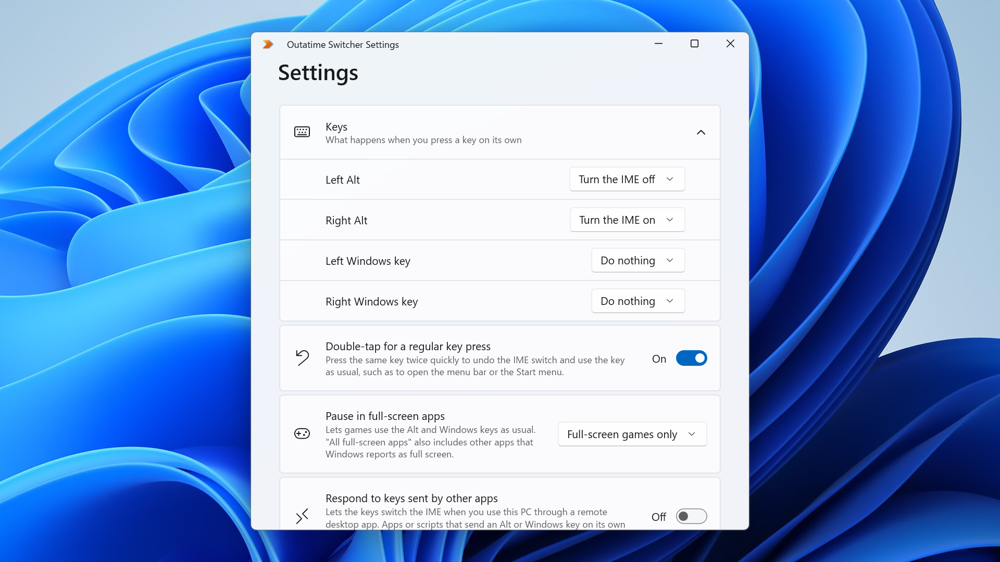

<div align="center">
  
  <h1>Outatime Switcher</h1>
  <a href="https://github.com/yk4to/outatime/actions/workflows/ci.yml"></a>
  
  <a href="LICENSE"></a>
  <br>
  <br>
  English | <a href="README.ja.md">日本語</a>
  <br>
  <br>
  
  <br>
  <br>
</div>

> Switch the IME with a tap of the Alt or Windows key

## Features

- **One-tap switching**: Tap Alt or the Windows key on its own to toggle the IME, or to turn it on or off. Choose an action for each of the four keys.
- **Shortcuts still work**: Only a lone tap counts, so Alt+Tab, Win+E and the rest work as usual. A tap doesn't open the menu bar or the Start menu.
- **Double-tap for the usual key**: Tap the same key twice quickly to undo the switch and get the key's own action.
- **Game-friendly**: Pauses in full-screen games, or in any full-screen app.
- **Lightweight**: A tiny native process in the notification area that doesn't need 1.21 jigowatts to run.
- **Easy to configure**: Use the settings app that fits right into Windows 11, or edit the JSON file. Changes apply right away.
- **Multilingual**: English, Japanese, Korean and Chinese (Simplified and Traditional).

## Installation

<a href="https://apps.microsoft.com/detail/9NBT2WKZPL28?mode=direct"></a>

Get it from the [Microsoft Store](https://apps.microsoft.com/detail/9NBT2WKZPL28), then start Outatime Switcher from the Start menu. Start it again to open the settings.

You can also build the zip version yourself (see [Building](#building)), extract it anywhere and run `Outatime.exe`. Run it again to open the settings.

Requires Windows 10 version 2004 or later (x64).

## Notes

- **Apps running as administrator**: Windows doesn't let a regular app see keys typed into apps running as administrator, so tapping does nothing there. In the zip version, set "Start at sign-in" to "On, as administrator" to cover them. The Store version doesn't have this option yet.
- **Remote desktop**: When you use the PC through a remote desktop app, keys arrive as sent by another app and are ignored by default. Turn on "Respond to keys sent by other apps".
- **SmartScreen**: The zip isn't code-signed, so Windows may warn you the first time you run it. The Store version is signed by Microsoft.
- **Separate settings**: The zip and Store versions keep their settings in different places. They don't share them.

## Building

Requires Visual Studio 2026 with the "Desktop development with C++" and "WinUI application development" workloads.

```powershell
cmake --preset default
cmake --build --preset debug
ctest --preset debug
dotnet build src/Outatime.Settings
```

`scripts/package.ps1` builds the zip and the MSIX package into `dist`.

## License

[MIT](LICENSE)
